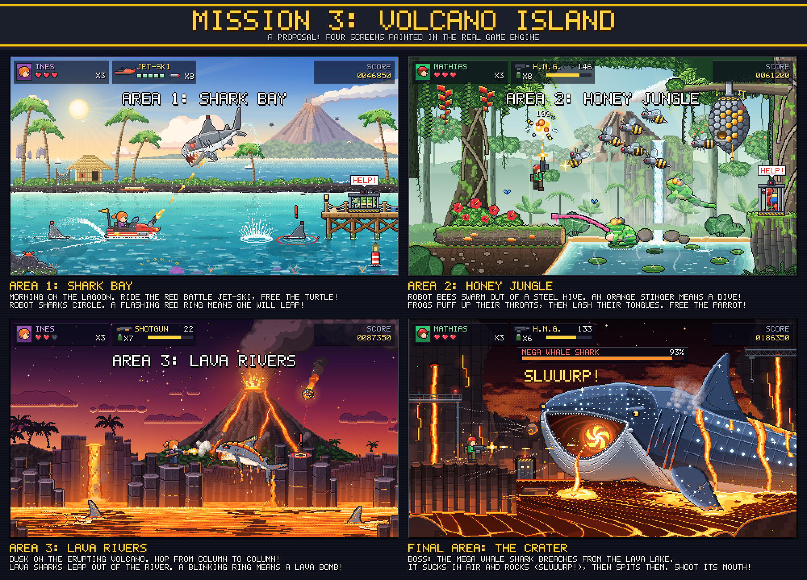

# Mission 3: VOLCANO ISLAND (proposal)

These are four mock screenshots, one for each area. The real game engine painted them, so the hero, the HUD, the
font and the size are exactly what you would see in the game. Nothing is playable yet: they are here so you and the
kids can choose before the level is built.

**The story:** Ines or Mathias sail to a tropical island. The robot army has hidden its base inside the volcano. You
cross the bay, climb through the jungle and the lava, and face their biggest robot in the crater. The time of day
moves on as you play: morning, late morning, dusk, then night.

## The four areas

| Area | Where | What you do |
|---|---|---|
| **1: SHARK BAY** | Morning, a turquoise lagoon, a black-sand beach, palm trees and a wooden pier. The volcano smokes far away. | Ride the red **BATTLE JET-SKI** over the water and free a **sea turtle** caged on the pier. |
| **2: HONEY JUNGLE** | Steamy jungle on the volcano's lower slopes: giant leaves, flowers, a waterfall and a hot-spring pond with lily pads. The volcano peeks through the trees. | Fight on foot. Jump on the log, the lily pads and a mossy ledge, and free a **parrot**. |
| **3: LAVA RIVERS** | Dusk on the erupting volcano: black basalt columns with glowing lava rivers between them. | Hop from column to column. Touching the lava costs a heart and bounces you back up. |
| **FINAL: THE CRATER** | Night inside the volcano: glowing walls, a lava lake and the robots' catwalks, crane and blast door. | Beat the boss from a ledge of basalt columns. |

## The robots, and how each one warns you

All of them are cartoon robot animals like the wolves and the bear: chunky, outlined, one glowing eye, never scary.
When you beat one, it bursts into bolts and plates.

- **Robot shark** (Shark Bay). Its fin circles on the surface; you can see its dark shape under the water. **Warning:**
  it stops, ripples spread, a red and yellow ring flashes on the water, a red **!** pops up and its beacon blinks
  fast. Then it leaps at you in a high arc with its jaws open. Jump it with the jet-ski, steer out of the ring, or
  shoot it in the air for bonus points.
- **Robot bees** (Honey Jungle). They pour out of a steel hive in a V. **Warning:** one bee's stinger glows orange
  (getting ready), then white with a sparkle (move now!). Then it dives straight at where you were standing. Shoot
  the hive to stop the swarm; it is worth big points and drops honey bonuses.
- **Robot frogs** (Honey Jungle). They sit on lily pads and logs. **Warning:** the throat puffs up with a croak, then
  the long pink sticky tongue whips out at standing height, so jump over it. Leaping frogs show a growing shadow
  where they will land.
- **Lava sharks** (Lava Rivers). Robot sharks with red-hot armour plates that swim in the lava with a glowing wake.
  **Warning:** the fin slows, the wake turns white-hot, bubbles swell and the eye blinks. Then the shark leaps over
  the gap toward your column.
- **Lava bombs** (Lava Rivers). The volcano rumbles. **Warning:** a blinking ring with a **!** appears where the bomb
  will land, about 1.5 s early. You can shoot the bomb in the air.

## The boss: MEGA WHALE SHARK

A gigantic robot whale shark rises out of the lava lake. It has a huge flat head and a wide mouth, glowing white
spots, gills that puff steam and lava pouring off its back. Goofy-cool: its eyes follow you, and its attacks come
with comic words.

- **VACUUM (SLUUURP!).** The mouth gapes, the throat glows white and a fan spins up inside. Then it sucks in air,
  sparks, rocks and even lava, and pulls you toward it. Walk or jump away. The open throat is its **weak spot**: shots
  do double damage, and a grenade sucked in is a big hit (**BURP!**).
- **ROCK SPIT (PTOO!).** The mouth shuts, the cheeks bulge, then it spits 3 lava rocks in arcs. A red ring and a
  **!** blink first where each rock will land. You can shoot the rocks.
- **DIVE.** It sinks until only its fin shows. Bubbles and a growing glow show where it will burst out next, so get
  back to the ledge.
- **Below half health,** armour plates pop off, the vacuum gets stronger and the gills shoot steam jets you duck
  under.
- **When it is beaten,** a rock jams its fan, its lights go out one by one and it sinks with a huge burp of bolts.

## Rescues and the ride

- **Rescues:** island animals in robot cages shouting **HELP!**: a sea turtle on the pier and a parrot in the jungle
  (a little monkey could replace the parrot or join it). Free them by shooting the cage or touching it. They say
  THANK YOU! and drop an item.
- **BATTLE JET-SKI:** it works like Mission 2's tractor. Board it at the beach (GET IN!) and steer left and right.
  - Z hops over waves, fins and leaping sharks.
  - X fires the nose gun; hold Up to swing it up at a leaping shark.
  - C fires torpedoes, 8 of them.
  - It has 5 armour pips. Down + Z hops off onto the pier.

## Music idea

Mission 2 has a Galician bagpipe jig. Mission 3 would get an **island tune**: a bright, bouncy melody on the triangle
sound (like a steel drum), with a calypso drum pattern and a bass that walks up and down.

- In **Lava Rivers** the same tune turns to a minor key, faster and with a heavier bass.
- The **boss** gets its own driving minor theme, with a rising whoosh before each SLUUURP!

## Open choices for you and the kids

1. **Jet-ski:** is all of Shark Bay a water ride, or only part of it, like the tractor in Mission 2, with beach bits
   on foot?
2. **Jungle rescue:** the parrot (as painted), a little monkey, or both?
3. **Frog tongue:** does it just hit you, or does it stick and pull you in until you jump or shoot free?
4. **Whale shark vacuum:** does it really drag the hero toward its mouth, so you have to run against it? Or does it
   only suck in rocks and lava for you to dodge? And if it catches you, does it spit you out with a PTOO! (and you
   lose a heart)?
