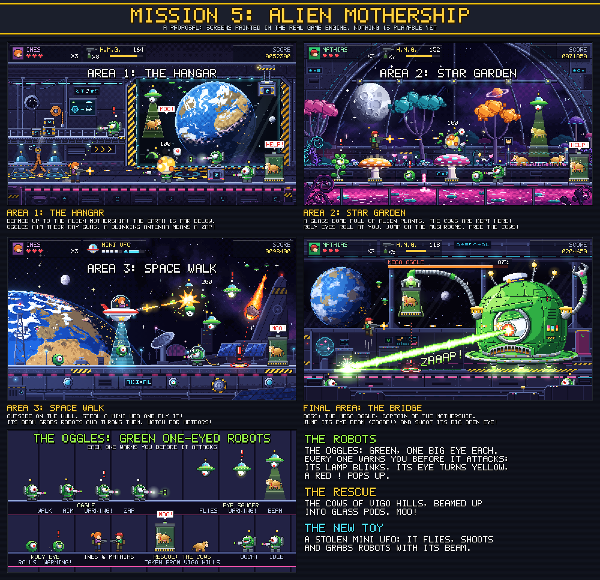
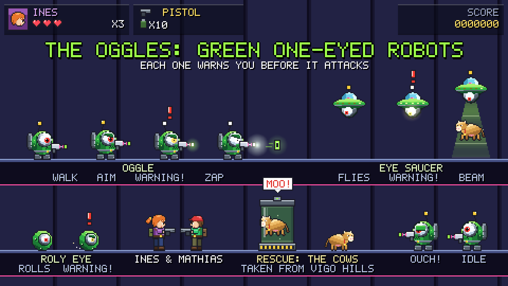

# Mission 5: ALIEN MOTHERSHIP (proposal)

These are mock screenshots, one for each area, plus the robot cast. The real game engine painted them, so the hero,
the HUD, the font and the size are exactly what you would see in the game. Nothing is playable yet: they are here so
you and the kids can choose before the mission is built. Nothing in the game has changed.

**The story:** the robot armies of Missions 1 to 4 were sent by a green alien mothership parked above the Earth. Its
robots are beaming up the cows of Vigo Hills. Ines and Mathias get beamed up too, fight through the ship, free the
cows and face the captain.

## The four areas

| Area | Where | What you do |
|---|---|---|
| **1: THE HANGAR** | The docking bay. A huge open bay door with the Earth behind it, parked saucers on striped pads, cargo crates, a crane, a catwalk. | Fight on foot. Robots shoot down from the catwalk; climb the crates to reach them. Parked saucers sleep until the alarm. The crane drops crates: a striped shadow warns you first. Free the first cow. |
| **2: STAR GARDEN** | A glass dome full of alien plants in pink, teal, orange and violet, the Moon outside. The cows are kept here behind a force-field fence. | Cross a glowing pond on giant mushroom caps (pink ones bounce you higher). Shoot the fence posts and the herd stampedes over the robots. |
| **3: SPACE WALK** | Outside on the hull, in open space. The Earth below, antenna dishes, solar panels, the ship's big fin. | Floaty low-gravity jumps on foot, then steal a **MINI UFO** and fly it. Meteors fall: a blinking ring shows where. |
| **FINAL: THE BRIDGE** | The control room: a wide window with the Earth and the Moon, glowing consoles, a hologram of the Earth. | Beat the captain, the MEGA OGGLE. |

## The robots: the OGGLES

Green, one big eye each, comic and never scary. Green is used only for the robots (the ship is blue-violet with
pink, cyan and amber lights), so they always stand out. Every one warns before it attacks: its antenna lamp blinks,
its eye turns yellow and a red **!** pops up. When you beat one it bursts into plates and bolts, and its eye pops out.

- **Oggle** (the trooper). Walks up and aims its ray gun. **Warning:** the gun tip glows, then one slow green ring
  flies at you. Jump it or duck.
- **Eye saucer.** Flies in threes. **Warning:** its eye turns yellow, then it dives or drops its beam on you. Some
  carry a cow in their beam: shoot the saucer and the cow floats down safely for a bonus.
- **Roly eye.** A rolling ball. **Warning:** it stops, hops and sparks, then dashes along the floor. Jump it, or
  crouch and shoot.
- **Eye flower** (Star Garden). A robot flower on a steel stalk, shut like a bud. **Warning:** the bloom snaps open
  with a yellow eye for about a second, then it spits one slow seed you can shoot. Shoot the eye while it is open.

## The boss: MEGA OGGLE

The captain of the mothership: a giant green robot with one enormous eye, heavy eyelids, a crown of antennae, a tiny
captain's cap and medals. It hovers on a saucer skirt and has two long claw arms. Its eye follows you.

- **Weak spot:** only the open eye takes damage. Shots on the armour just clank.
- **EYE BEAM (ZAAAP!).** The three antenna lamps light up one, two, three, the eye turns yellow and a dotted line
  shows where the beam will go. Then the beam sweeps along the floor at walking pace. Jump over it once. The eye is
  wide open while it fires, so your shots count double.
- **TRACTOR DROP.** A claw fetches a pod or a crate. A red ring and a **!** follow you, then stop. Walk out of the
  ring. A dropped cow pod cracks open and frees the cow, who leaves you a heart or ammo.
- **EYELIDS SHUT.** After enough hits the eyelids slam shut and shots ping off. It sweeps a claw along the floor
  (jump it) or rolls out roly eyes, then the lid lifts again.
- **Below half health,** its cap is blown off, one eyelid jams half open, the beam sweeps there and back, and it
  dashes across the room (the lamps on its skirt flash first), hits the wall and sits dizzy.
- **When it is beaten,** its eye goes spiral, it spins, the pods pop open and the freed cows stampede over it. The
  cap lands on a cow.

## Rescues and the ride

- **Rescues:** the cows of Vigo Hills (golden Galician cows with a bell), floating in glass pods and shouting
  **MOO!** and **HELP!**. Free them by shooting the pod or touching it.
- **MINI UFO:** a stolen saucer, silver with a red stripe and a yellow star, so it never looks like an enemy. It
  works like Mission 2's tractor and Mission 3's jet-ski, but it flies.
  - Arrows fly it in every direction. X fires the yellow blaster.
  - Hold C over a robot or a crate to lift it with the cyan beam; let go to throw it. Roly eyes make the best
    ammunition. The beam has a charge bar that drains in about 3 seconds and refills.
  - It has 5 armour pips. When they are gone it pops and you fight on foot until the next parked one.

## Music idea

A spooky-funny space tune: a wobbly sine-wave lead (like an old flying-saucer film), a bouncing bass and light
ticking drums. In the Star Garden it turns sweet and slow; on the hull it speeds up. The boss gets a heavy march
with a rising siren before each ZAAAP!

## Open choices for you and the kids

1. **The robots' name:** OGGLES (as written here), or a name the kids pick? Same for the mission title and the boss.
2. **Space Walk:** part on foot with floaty jumps and part in the mini UFO (as proposed), or the whole area in the UFO?
3. **The UFO's beam:** grab robots and throw them (as painted), or keep it simple with only the blaster?
4. **Rescues:** only cows, or other animals from Vigo Hills too (a sheep, the dog)?
5. **The Earth:** its land is painted sand-coloured so that only the robots are green. Keep that, or green land?
