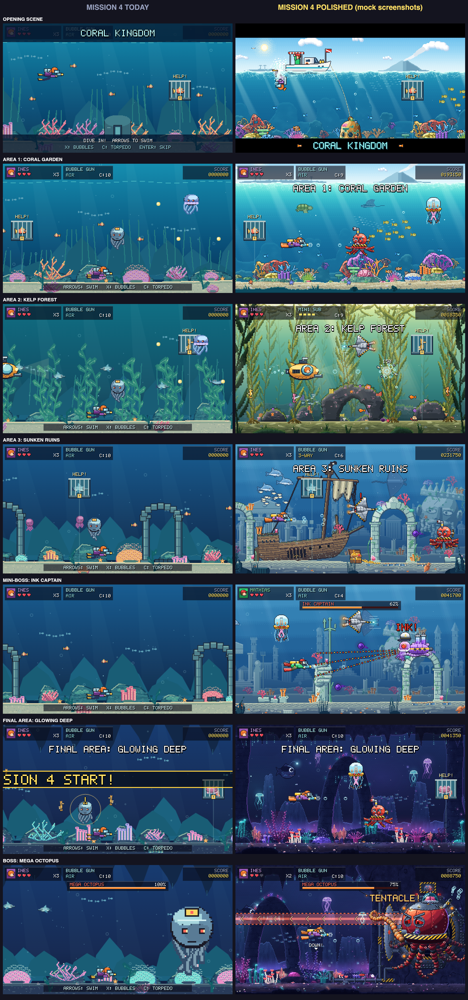
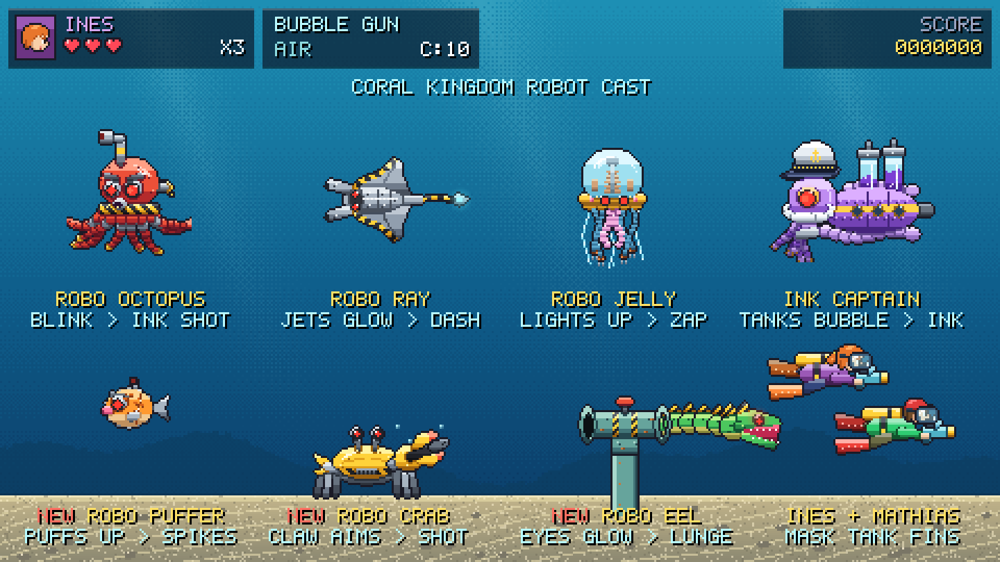

# Mission 4 polished (proposal)

Mission 4 (CORAL KINGDOM) works from start to finish, but it looks and plays well below Missions 2 and 3:
plain water, triangle hills, robots that are all the same grey, and a boss that is just the small octopus made
three times bigger. The pictures on the right are mock screenshots painted by the real game engine (real HUD,
real font, real hero). Nothing in the game has changed yet.

## 1. All four areas repainted

Same level, same rescues, same places. Only the look changes; the light gets darker the deeper you dive.

| Area | Today | Polished |
|---|---|---|
| **1: CORAL GARDEN** | Flat blue, a few thin corals. | Sunny shallows: the surface rippling above you with Volcano Island on the horizon, big colourful reef, clownfish in anemones, a sea turtle, shoals of fish. |
| **2: KELP FOREST** | Green zig-zag weeds. | Golden light through a tall swaying kelp forest, a rock arch, sea horses, a hermit crab. The yellow mini-sub is parked here. |
| **3: SUNKEN RUINS** | Two grey arches. | A drowned city with a giant sunken king's head, a pirate shipwreck (the dolphin cage hangs from its mast), a treasure chest spilling coins, dolphins and a manta. |
| **FINAL: GLOWING DEEP** | Dark blue and triangles. | A glowing cave: coral that lights up in pink, cyan and violet, glowing jellyfish, a friendly anglerfish, and the Mega Octopus's robot-factory lair. |

## 2. An opening scene

Missions 2 and 3 open with a little arrival scene. Mission 4 would open with the heroes' dive boat on the sunny sea:
one hero waves from the boat, the other rolls backwards into the water with a big splash and swims down to the
reef. Then MISSION 4 START!

## 3. A real robot army

Each robot gets its own colour and shape, and each one warns you before it attacks (a blinking **!**, a part that
lights up, dotted lines showing where the shot or dash will go):

- **Robo Octopus** (red): periscope blinks, then an ink shot.
- **Robo Ray** (steel): jets glow, then a dash along the dotted line.
- **Robo Jelly** (glass bell): lights up, then ZAP! in six directions.
- **INK CAPTAIN** mini-boss (purple, captain's hat, moustache): ink tanks bubble, then three ink blobs.
- **New: Robo Puffer**: puffs up into a spiky ball, then spikes fly out.
- **New: Robo Crab**: walks on the sand, aims its claw cannon up, then one slow shot.
- **New: Robo Eel**: red eyes glow in a pipe, then it lunges out.

Ines and Mathias get proper dive gear in their own colours (mask, yellow tank, fins).

## 4. A real final boss: MEGA OCTOPUS

A big red robot octopus with a grumpy brain in a glass dome, eight armoured tentacles that wave on their own, and
clear warnings: before the tentacle swipe the whole row lights up and the game tells you UP! or DOWN!. When it's
hurt its dome cracks and it sparks; when it's beaten its eyes go spiral, bolts pop off and it waves a little white
flag. (More pictures: `boss/boss-low.png`, `boss/boss-ko.png`.)

## 5. Fair and fun like Mission 2

The test bot (it never dodges) played Mission 4 today:

| | Time | Hits taken | Where the hits come from |
|---|---|---|---|
| Mission 4 today | 124 s | 14 | Areas 1-2: none, Area 3: 2, boss: 12 |
| Mission 2 (the one you liked) | 150-170 s | 10-14 | spread over every area |

So today Mission 4 is short, too easy at the start and too hard at the end. The plan: more robots in Areas 1-3
(using the three new ones), a fairer boss, and the same numbers as Mission 2.

## Open choices for you and the kids

1. **The boss's size:** keep it this big, filling the right side of the screen (my pick), or a bit smaller so it
   climbs out of its lair door?
2. **New robots:** all three, puffer + crab + eel (my pick), or only some of them?
3. **Weak spot:** the boss's glass brain dome takes double damage (my pick: it gives kids something to aim at),
   or the whole body counts the same?
4. **Difficulty:** bring it to Mission 2's level (my pick), or leave it as it is?

## What stays as it is

- Missions 1, 2 and 3: nothing changes.
- Mission 4's map, rescues, controls (swim in all directions, X bubbles, C torpedo, Enter for the mini-sub) and
  music.

## Honest notes

- The mocks were painted separately, so where one area hands over to the next there is still a rough join; fixing
  those is part of the build.
- In the opening-scene mock the diver still wears today's colours; in the game it would wear the new dive gear.
- The new scenery takes a moment to paint the first time Mission 4 starts; that would be hidden behind the
  loading bar.
