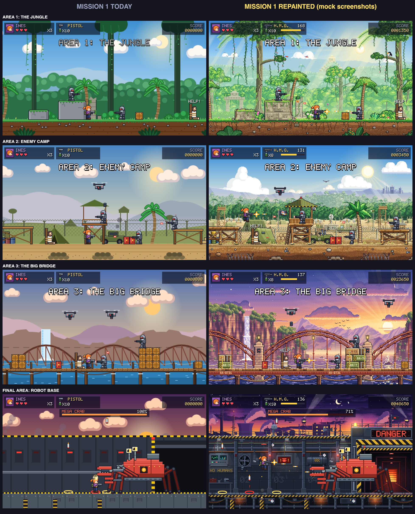
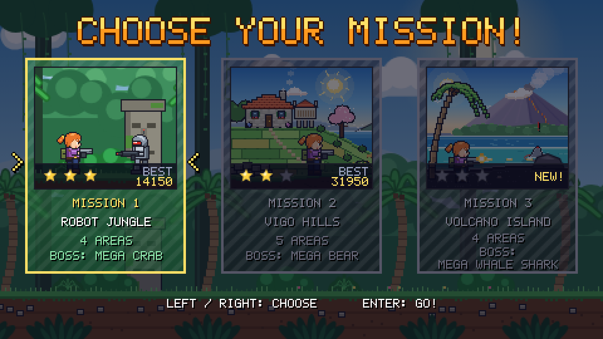

# A more polished Robot Rumble (proposal)

Missions 2 and 3 already look and play the way you liked. Mission 1 is the oldest part of the game and it shows:
it is the plainest to look at, it has no opening scene, and it is the hardest of the three. So this polish pass is
mostly about lifting Mission 1 to the level of the other two, plus one thing for the whole game: cards that
remember your stars.

The pictures on the right are mock screenshots painted by the real game engine: the hero, the robots, the HUD and the
font are the real ones. Nothing in the game has changed yet.

## 1. Mission 1 repainted

Same level, same platforms, same robots in the same places. Only the look changes.

| Area | Today | Repainted |
|---|---|---|
| **1: THE JUNGLE** | Rows of green circles and flat trunks. | A morning rainforest with depth: misty hills, a far pyramid, giant trees with vines, light shafts, a toucan. The grey rocks become carved temple blocks. |
| **2: ENEMY CAMP** | A tan strip, a hill and a see-through fence. | A camp cut out of the jungle at midday: tent rows, a turning radar, watchtowers, a real fence with barbed wire, timber scaffolds, the robot base far away on the mountains. |
| **3: THE BIG BRIDGE** | Pink hills and a pale rectangle for a waterfall. | A sunset gorge: cliffs with jungle and a real waterfall, purple mountains, riveted steel arches, stone pillars with lanterns, the sun glittering on the river. |
| **FINAL: ROBOT BASE** | Flat grey panels. | The base at dusk: a factory skyline with searchlights, a riveted wall with pipes, fans and screens, and a heavy blast door with a DANGER sign that the Mega Crab comes out of. |

The title screen and the menus use Mission 1's scenery as their backdrop, so they get the new look too.

## 2. An opening scene for Mission 1

Mission 2 opens at the house in Vigo and Mission 3 with the boat reaching the island. Mission 1 just starts.
It would get the same kind of short arrival, with black bars and a place name (**DEEP IN THE ROBOT JUNGLE**), before
MISSION 1 START!

## 3. A fairer Mission 1

The test bot (which never dodges) played each mission on six different runs:

| | Hits taken | Lives lost | Needed a continue |
|---|---|---|---|
| Mission 1 today | 12-24 | 4-7 | every run |
| Mission 2 (the one you liked) | 10-14 | 0-2 | never |

So the first mission is the hardest one. Most hits come from four things, and each would get a clear warning, the
way Missions 2 and 3 already do it:

- **Mega Crab's orb bursts** (the biggest cause): the claw glows and locks its aim before it fires, with fewer orbs
  and a gap you can jump through.
- **Tank shells and drone bombs:** a blinking ring on the ground where each one will land, like Mission 3's lava bombs.
- **Soldier lasers:** a slightly longer, more visible aim flash before the shot.

Target: the same numbers as Mission 2.

## 4. Mission cards that remember your stars

Today the stars you win disappear after the MISSION COMPLETE screen. Each mission card would keep your best stars
and best score, and a mission you haven't finished yet says NEW! It gives the kids a reason to go back for three
stars (finish, rescue everyone, no continue).

## What stays as it is

- Missions 2 and 3: their art, robots and difficulty are not touched (only their cards gain stars).
- Mission 1's layout, robots, pickups, music and score values.
- Your saved best score.

## Open choices for you and the kids

1. **How does the hero arrive in Mission 1?** By parachute from a plane (my pick), down a rope from a helicopter,
   or by small boat up the river.
2. **The Mega Crab:** repaint it with shading to match the new base, same shape and same attacks (my pick), or
   keep it exactly as the kids know it? Next to the painted base it looks flat.
3. **Mission 1's difficulty:** bring it down to Mission 2's level (my pick), or leave it as it is?
4. **Stars:** keep all three missions open from the start (my pick), or make each one unlock by finishing the one
   before?

## Honest notes

- The four mocks were painted separately. Where one area hands over to the next (jungle to camp, camp to bridge,
  bridge to base) there is still a rough seam; fixing those is part of the build.
- The breakable crate and the red barrels still have their old flat look in the mocks; they would be repainted too.
- The hero carries the heavy machine gun in the mocks only because it makes a livelier picture.
- The new scenery takes a moment to paint the first time Mission 1 loads. That has to be checked on your Mac in the
  real browser, and spread out so the game doesn't pause.
